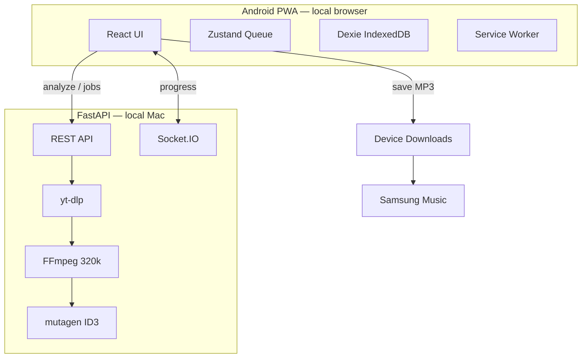

# DgLabs — University Submission Package

> **Local demo URL:** http://YOUR-MAC-LAN-IP:5173  
> **Repository:** https://github.com/dagim-dev/musicWeb  
> **Backend:** http://127.0.0.1:8000/api/v1

---

## Project summary

DgLabs is an **Android-first Progressive Web App** that downloads YouTube audio as **320 kbps MP3** files with full **ID3v2.3 metadata** (artist, album, track number, embedded cover art). Files save to the device Downloads folder and appear in **Samsung Music** after a media scan.

Built as a full-stack university project: React/Vite frontend, FastAPI media pipeline, and real-time progress via Socket.IO, all run locally on a Mac and reached from a phone over the same Wi‑Fi network.

---

## Milestone checklist (all verified)

| #   | Milestone                                               | Status |
| --- | ------------------------------------------------------- | ------ |
| M0  | Dev environment — backend running and media tools ready | ✅     |
| M1  | Paste URL → MP3 in Android Downloads with tags          | ✅     |
| M2  | Add to Home Screen → standalone PWA                     | ✅     |
| M3  | Playlist/album download with per-track progress         | ✅     |
| M4  | Library visible offline (local metadata)                | ✅     |
| M5  | Re-paste URL → duplicate detection modal                | ✅     |
| M6  | Local LAN access from phone browser                     | ✅     |
| M7  | 3-minute demo flow (install → download → Samsung Music) | ✅     |

---

## Architecture



### Tech stack

| Layer        | Technology                                        |
| ------------ | ------------------------------------------------- |
| Frontend     | React 19, Vite, TypeScript, Tailwind CSS v4       |
| Client state | Zustand, TanStack Query, Dexie.js                 |
| PWA          | vite-plugin-pwa, Workbox, install prompt          |
| Backend      | FastAPI, python-socketio, uvicorn                 |
| Media        | yt-dlp, FFmpeg (libmp3lame 320k), mutagen, Pillow |
| Security     | CORS origin lock, slowapi rate limits             |
| Workflow     | Local dev + same-Wi‑Fi access                     |

---

## Key features demonstrated

- Installable PWA with custom icons and dark/light theme
- YouTube video, playlist, and album-style URL analysis
- Per-track pipeline stages: download → convert → tag → deliver
- Real-time Socket.IO progress with REST polling fallback
- Download queue with reorder, cancel, retry failed tracks
- Individual MP3 or streaming ZIP for playlists
- Local library with offline metadata and cached cover thumbnails
- Duplicate detection before re-downloading
- Library export/import (JSON backup)
- Samsung Music integration (post-download shortcut)

---

## 3-minute demo script

See [`DEMO.md`](./DEMO.md) for the full presenter script.

**Quick flow:**

1. Open `http://YOUR-MAC-LAN-IP:5173` on Android Chrome
2. Install to Home Screen if supported by the browser
3. Paste a YouTube URL → Analyze → Add to Queue
4. Show per-track progress stages
5. Tap **Open Samsung Music** → verify artist, album, cover art
6. Library tab → show offline history and duplicate detection

---

## API endpoints

| Method | Path                                | Purpose                               |
| ------ | ----------------------------------- | ------------------------------------- |
| POST   | `/api/v1/analyze`                   | Parse YouTube URL                     |
| POST   | `/api/v1/jobs`                      | Start download job                    |
| GET    | `/api/v1/jobs/{id}`                 | Job status (polling)                  |
| GET    | `/api/v1/jobs/{id}/tracks/{n}/file` | MP3 download                          |
| GET    | `/api/v1/jobs/{id}/zip`             | Playlist ZIP                          |
| DELETE | `/api/v1/jobs/{id}`                 | Cancel job                            |

---

## Local development

```bash
docker compose up --build
# Frontend: http://localhost:5173
# Backend:  http://localhost:8000/api/v1
```

See [`README.md`](./README.md) for the local setup and LAN access notes.

---

## Known limitations (documented)

- PWA saves to Downloads via browser pipeline — not direct Samsung Music library injection
- 320 kbps re-encodes best available YouTube source (cannot exceed source quality)
- Some YouTube URLs may fail if the upstream extractor changes or the source is restricted
- No user accounts or in-app audio player (out of scope)

---

## Disclaimer

This project is for **educational demonstration only**. It is not intended for production use or copyright-infringing distribution.
