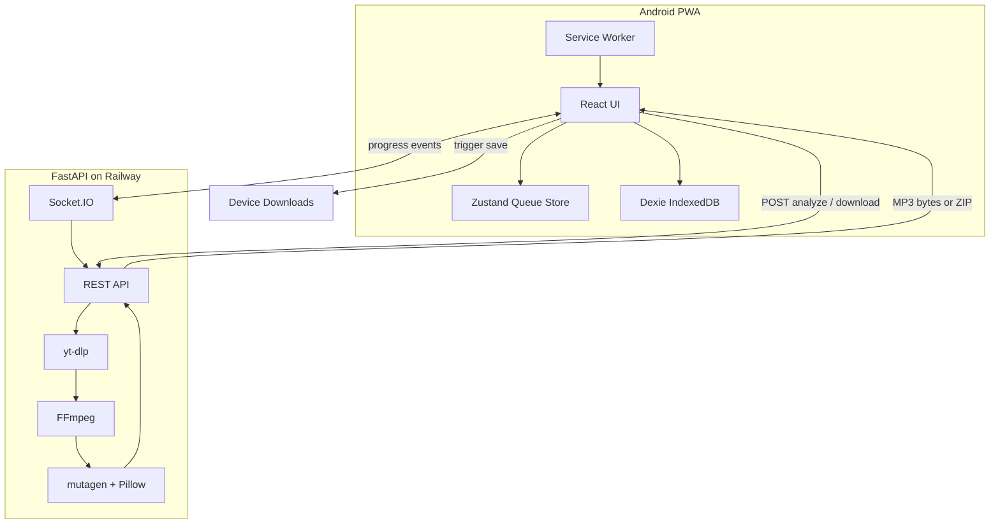
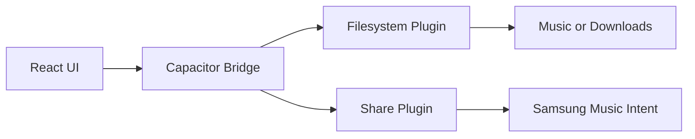
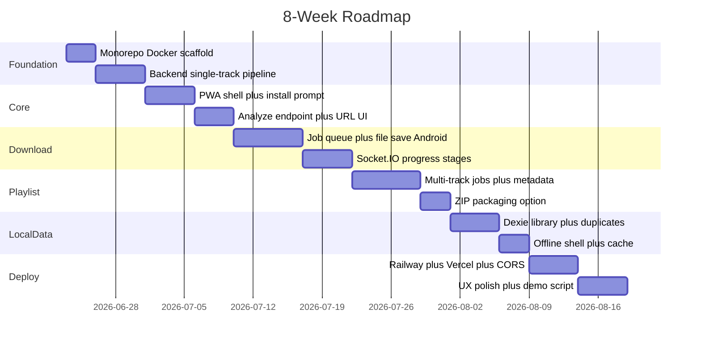

# YouTube-to-MP3 PWA — Senior Architecture Plan

**Context:** Empty workspace at [`/Users/dagi/musicWebsite`](/Users/dagi/musicWebsite). Android-only target, 6–8 week timeline, university demo (legal constraints acknowledged as out of scope).

**Critical platform reality (Android PWA):** A browser-based PWA cannot write directly into Samsung Music’s internal library. Files are saved via the browser download pipeline (typically `Downloads/`). Samsung Music picks them up when it scans storage — **ID3 tags and cover art quality matter more than folder path**. Design the UX around “download complete → open Samsung Music to play,” not silent library injection.

---

## System Overview (Shared Across Versions)



---

# Version 1 — Full-Stack Cloud Architecture (Your Spec, End-to-End)

## 1. Overview

The complete product as described: React + Vite PWA on Vercel, FastAPI + yt-dlp + FFmpeg on Railway (Docker), Socket.IO for per-track progress, Dexie for local library/history/duplicate detection, playlist + album support, ZIP packaging for multi-track jobs.

**Best for:** Maximum demo polish, matches your rubric/stack requirements, deployable URL for markers.

## 2. Architecture

| Layer | Technology | Role |
|-------|------------|------|
| Frontend | React 18 + Vite + TypeScript | SPA shell, routing, UI |
| Styling | Tailwind CSS + `@tailwindcss/forms` | Mobile-first premium UI |
| Server state | TanStack Query v5 | Analyze URL, health, job status |
| Client state | Zustand | Download queue, active tab, UI mode |
| Persistence | Dexie.js | Library, history, duplicate index |
| PWA | `vite-plugin-pwa` + Workbox | Manifest, SW, offline shell |
| Backend | FastAPI (async) | REST + job orchestration |
| Realtime | `python-socketio` + `uvicorn` | Per-track progress |
| Extract | yt-dlp | URL resolve, playlist parse, metadata |
| Convert | FFmpeg | MP3 @ 320 kbps (`libmp3lame -b:a 320k`) |
| Tags | mutagen (ID3v2.3) + Pillow | Artist, album, track #, APIC cover |
| Security | CORS + slowapi | Origin lock + rate limits |
| Deploy | Vercel + Railway + Docker | CDN frontend, container backend |

**Job model:** Each paste → `AnalyzeJob` → user confirms tracks → `DownloadJob` with N `TrackTasks`. Backend processes sequentially (or limited parallelism=2 to protect Railway CPU). Socket.IO rooms keyed by `job_id`.

## 3. Feature Set

**MVP-critical (Week 1–4)**
- PWA install prompt (`beforeinstallprompt`), standalone display, custom icons
- Paste YouTube URL → analyze single video / playlist / album-style playlist
- Per-track download with stages: `queued → downloading → converting → tagging → delivering → done`
- Real-time progress: “Track 4 of 12”, “Converting 67%”, “Embedding metadata”
- MP3 320 kbps output with ID3 metadata
- Android file save via `fetch` + Blob + `<a download>` (and `showSaveFilePicker` fallback where supported)
- Local library list (metadata from Dexie; files referenced by filename + download timestamp)
- Duplicate detection by `youtube_video_id` (+ optional title hash)
- Download queue (add multiple URLs, reorder, cancel)

**Polish (Week 5–6)**
- Playlist ZIP option (“Download all as ZIP” + individual files mode)
- Dark mode, haptic-style micro-interactions, skeleton loaders
- Offline: app shell + library browsing (cached metadata + cover thumbnails in IndexedDB)
- Error recovery: retry failed tracks, resume queue
- Empty states, onboarding carousel for install + Samsung Music tip

**Stretch (Week 7–8)**
- Batch rename templates (`{artist} - {title}.mp3`)
- Export/import library backup (JSON)
- Server-side job persistence (Redis) for reconnect after tab kill

## 4. Development Phases

| Phase | Duration | Deliverable |
|-------|----------|-------------|
| 0. Scaffold | 2–3 days | Monorepo, Docker local, CI skeleton |
| 1. Backend core | 5–7 days | Analyze + single-track MP3 pipeline |
| 2. Socket.IO progress | 3–4 days | Stage events + FFmpeg progress parse |
| 3. Frontend shell + PWA | 4–5 days | Installable app, routing, design system |
| 4. Download flow | 5–6 days | Queue, progress UI, file save |
| 5. Library + duplicates | 3–4 days | Dexie schema, library screen |
| 6. Playlist/album | 4–5 days | Multi-track jobs, ZIP packaging |
| 7. Deploy + harden | 4–5 days | Vercel/Railway, CORS, rate limits |
| 8. Polish + demo | 3–5 days | UX pass, README, demo script |

## 5. Folder Structure

```
musicWebsite/
├── frontend/
│   ├── public/
│   │   ├── icons/                  # 192, 512, maskable
│   │   └── favicon.ico
│   ├── src/
│   │   ├── api/                    # axios/fetch clients
│   │   ├── components/
│   │   │   ├── ui/                 # Button, Card, Progress, Toast
│   │   │   ├── download/           # UrlInput, QueueItem, ProgressStages
│   │   │   └── library/            # TrackList, TrackCard, DuplicateModal
│   │   ├── db/
│   │   │   ├── schema.ts           # Dexie tables
│   │   │   └── libraryRepository.ts
│   │   ├── hooks/
│   │   │   ├── usePwaInstall.ts
│   │   │   ├── useDownloadSocket.ts
│   │   │   └── useDuplicateCheck.ts
│   │   ├── pages/
│   │   │   ├── HomePage.tsx        # URL paste + queue
│   │   │   ├── LibraryPage.tsx
│   │   │   └── SettingsPage.tsx
│   │   ├── stores/
│   │   │   └── downloadQueueStore.ts
│   │   ├── styles/
│   │   ├── App.tsx
│   │   └── main.tsx
│   ├── index.html
│   ├── vite.config.ts
│   ├── tailwind.config.js
│   └── package.json
├── backend/
│   ├── app/
│   │   ├── main.py                 # FastAPI + Socket.IO mount
│   │   ├── config.py               # CORS origins, rate limits, temp dir
│   │   ├── api/
│   │   │   ├── routes/
│   │   │   │   ├── analyze.py
│   │   │   │   ├── download.py
│   │   │   │   └── health.py
│   │   │   └── deps.py
│   │   ├── services/
│   │   │   ├── youtube.py          # yt-dlp wrapper
│   │   │   ├── converter.py        # FFmpeg subprocess + progress
│   │   │   ├── metadata.py         # mutagen ID3 tagging
│   │   │   ├── job_manager.py      # in-memory job registry
│   │   │   └── zip_builder.py
│   │   ├── models/
│   │   │   ├── analyze.py          # Pydantic schemas
│   │   │   └── download.py
│   │   └── sockets/
│   │       └── events.py
│   ├── Dockerfile
│   ├── pyproject.toml              # uv-managed
│   └── uv.lock
├── docker-compose.yml              # local dev: backend + optional redis
├── .github/workflows/
│   ├── frontend-deploy.yml
│   └── backend-deploy.yml
└── README.md
```

## 6. Database / Storage Design

**Frontend — Dexie (`MusicLibraryDB`)**

| Table | Key | Fields |
|-------|-----|--------|
| `tracks` | `id` (uuid) | `youtubeId`, `title`, `artist`, `album`, `trackNumber`, `duration`, `thumbnailUrl`, `fileName`, `fileSize`, `downloadedAt`, `sourceUrl` |
| `downloadHistory` | `id` | `jobId`, `trackId`, `status`, `completedAt`, `error` |
| `settings` | `key` | `value` (theme, defaultQuality, etc.) |

**Indexes:** `tracks.youtubeId` (unique), `tracks.[artist+album+title]` for fuzzy duplicate warning.

**Backend — ephemeral storage (no persistent DB v1)**
- `/tmp/jobs/{job_id}/{track_index}/` — raw audio, mp3, cover.jpg
- Cleanup on job complete or TTL cron (1 hour)
- Optional Week 7+: Redis for `job:{id}` state

## 7. API Design

**REST (prefix `/api/v1`)**

| Method | Path | Body | Response |
|--------|------|------|----------|
| GET | `/health` | — | `{ status, ffmpeg, ytdlp_version }` |
| POST | `/analyze` | `{ url: string }` | `{ type: "video"\|"playlist", title, entries: [{ id, title, artist, duration, thumbnail }] }` |
| POST | `/jobs` | `{ url, entry_ids?: string[], mode: "individual"\|"zip" }` | `{ job_id }` |
| GET | `/jobs/{job_id}` | — | Job snapshot (polling fallback) |
| GET | `/jobs/{job_id}/tracks/{index}/file` | — | `audio/mpeg` stream |
| GET | `/jobs/{job_id}/zip` | — | `application/zip` |
| DELETE | `/jobs/{job_id}` | — | Cancel + cleanup |

**Socket.IO events (room: `job:{job_id}`)**

| Event | Payload |
|-------|---------|
| `job:started` | `{ total_tracks }` |
| `track:progress` | `{ index, stage, percent, message }` |
| `track:complete` | `{ index, file_name, download_url }` |
| `track:error` | `{ index, error }` |
| `job:complete` | `{ zip_url? }` |

**Rate limits (slowapi):** 10 analyze/min/IP, 3 concurrent jobs/IP, max 50 tracks/job.

## 8. Frontend Design

**Navigation:** Bottom tab bar (native-app pattern) — Home (Download), Library, Settings.

**Home screen**
- Large URL input with paste button
- Analyze → expandable track list with select-all/deselect
- “Add to Queue” CTA
- Active queue section with per-item progress rings

**Library screen**
- Sortable list (date, artist, album)
- Search/filter
- Swipe or long-press → re-download / delete record

**PWA config highlights**
```json
{
  "name": "TuneFetch",
  "short_name": "TuneFetch",
  "display": "standalone",
  "orientation": "portrait",
  "theme_color": "#0f0f12",
  "background_color": "#0f0f12",
  "start_url": "/"
}
```

**Design tokens:** Dark-first palette (near-black `#0f0f12`, accent violet or teal), 16px base font, 48px touch targets, `safe-area-inset` padding for notched Android.

## 9. Backend Design

**Pipeline per track (`services/converter.py`):**
1. `yt-dlp -x --audio-format best` → temp `.m4a`/`.webm`
2. `ffmpeg -i input -codec:a libmp3lame -b:a 320k -map_metadata -1 output.mp3`
3. Fetch thumbnail → resize 500×500 JPEG via Pillow
4. `mutagen.id3` → `TPE1`, `TALB`, `TRCK`, `TIT2`, `APIC` (ID3v2.3 for Samsung compatibility)
5. Emit socket progress throughout

**yt-dlp playlist handling:** `extract_flat` for fast analyze; full extract on download. Map `playlist_title` → album, `playlist_index` → track number, `uploader` / `artist` → TPE1.

**FFmpeg progress:** Parse `stderr` for `time=` vs duration to compute percent during converting stage.

## 10. Deployment Process

1. **Backend Docker image** — `python:3.12-slim` + `apt install ffmpeg` + `uv sync` + `uvicorn app.main:app`
2. **Railway** — Connect GitHub repo, set `CORS_ORIGINS=https://your-app.vercel.app`, volume or ephemeral `/tmp`
3. **Vercel** — `frontend/` root, env `VITE_API_URL`, `VITE_SOCKET_URL`
4. **GitHub Actions** — lint + typecheck on PR; auto-deploy main
5. **Smoke test** — analyze known short video, download, verify ID3 with `ffprobe` / Samsung Music

## 11. Expected Challenges

| Challenge | Mitigation |
|-----------|------------|
| 320 kbps ≠ studio quality if source is 128k | Document in README; `-b:a 320k` re-encodes best available source |
| Railway CPU/memory limits on long playlists | Cap 50 tracks/job; sequential processing; progress UI sets expectations |
| Socket.IO through Railway proxy | Enable WebSocket transport; polling fallback via TanStack Query |
| Android download UX (no true “save to Music/”) | Post-download toast: “Open Samsung Music — your file is in Downloads” |
| yt-dlp breakage when YouTube changes | Pin yt-dlp version; `uv add yt-dlp` upgrade path in README |
| Large playlist ZIP memory | Stream ZIP with `zipstream-ng` instead of buffering |
| PWA update cache stale | `vite-plugin-pwa` `registerType: 'prompt'` |

## 12. Estimated Difficulty

**8/10** — Full-stack, realtime, media pipeline, PWA polish, deployment.

## 13. Estimated Development Time

**6–8 weeks** (solo, 15–20 hrs/week) — fits your timeline with stretch goals in weeks 7–8.

## 14. Pros and Cons

**Pros:** Matches your spec exactly; impressive demo; clear separation of concerns; marker-friendly deployed URL.

**Cons:** Highest ops complexity; Railway costs possible; Android download UX still browser-mediated.

---

# Version 2 — MVP-First, Same Stack (Phased Feature Delivery)

## 1. Overview

Identical tech stack as Version 1, but **strictly phased**: ship a working single-track downloader + PWA install in Week 2, then layer playlist, queue, library, duplicates.

## 2. Architecture

Same as V1, but:
- Phase 1: REST-only progress (polling `GET /jobs/{id}`) — add Socket.IO in Phase 2
- Phase 1: No ZIP — individual files only
- Phase 1: Library is a simple list, no search

## 3. Feature Set

| Phase | Weeks | Features |
|-------|-------|----------|
| A | 1–2 | PWA shell, single URL → MP3, basic progress bar |
| B | 3–4 | Playlist analyze, multi-track sequential download |
| C | 5 | Dexie library + duplicate modal |
| D | 6 | Socket.IO realtime + queue reorder/cancel |
| E | 7–8 | ZIP, dark polish, deploy |

## 4–10. Structure, API, Design, Deploy

Same as V1 — deferred components stubbed with feature flags (`VITE_FEATURE_ZIP=false`).

## 11. Challenges

Lower early risk; risk of “half-finished” demo if timeline slips — **mitigate with Phase A as minimum viable demo**.

## 12. Difficulty: **6/10** early → **8/10** at parity

## 13. Time: **4 weeks to usable demo**, 6–8 weeks to full parity

## 14. Pros and Cons

**Pros:** Always have something demoable; easier debugging; less blocked time.

**Cons:** Requires discipline to avoid stopping at Phase B; refactor cost if queue architecture rushed early.

---

# Version 3 — Capacitor Hybrid (Enhanced Android File Access)

## 1. Overview

Same React UI, wrapped with **Capacitor** for Android. Adds `@capacitor/filesystem` + `@capacitor/share` to save MP3s to `Music/` or share directly to Samsung Music.

## 2. Architecture

V1 architecture + Capacitor native bridge:



Backend unchanged (Railway). Frontend build produces APK/AAB via Android Studio **in addition to** PWA.

## 3. Feature Set

All V1 features plus:
- “Save to Music folder” toggle in Settings
- “Open in Samsung Music” share sheet after download
- Optional: native splash screen + status bar theming

## 4. Development Phases

Weeks 1–5: Build V1 web app → Week 6: `npx cap add android` → Week 7: Filesystem integration → Week 8: APK demo + PWA fallback.

## 5. Folder Structure

V1 + `frontend/android/` (Capacitor native project), `capacitor.config.ts`.

## 6–9. Storage, API, Frontend, Backend

Dexie unchanged. File save path uses Capacitor:

```typescript
// After receiving MP3 ArrayBuffer from backend
await Filesystem.writeFile({
  path: `Music/${artist}/${fileName}`,
  data: base64,
  directory: Directory.ExternalStorage,
});
```

## 10. Deployment

- PWA still on Vercel for markers who test in browser
- APK sideload for “true native” demo on your Samsung device
- Backend still Railway

## 11. Challenges

| Challenge | Mitigation |
|-----------|------------|
| Scoped storage on Android 11+ | Use `Directory.ExternalStorage` + `Music/` relative path; test on your device early |
| Two distribution paths (PWA + APK) | Document both in demo script |
| Extra toolchain (Android Studio) | Budget 1 week setup |

## 12. Difficulty: **9/10**

## 13. Time: **7–9 weeks** (tight for 6–8 unless Capacitor is primary deliverable)

## 14. Pros and Cons

**Pros:** Closest to “native app” file experience; Samsung Music integration via share intent; still same React codebase.

**Cons:** More tooling; university markers may only test PWA URL; Play Store not needed but APK signing adds friction.

---

# Version 4 — Local Docker Demo (No Cloud Dependency)

## 1. Overview

Full feature set runs on **your laptop via Docker Compose**. Phone on same Wi‑Fi hits `http://192.168.x.x:5173`. No Vercel/Railway until optional final week.

## 2. Architecture

```
docker-compose:
  backend:  FastAPI + FFmpeg (port 8000)
  frontend: Vite dev server or nginx static (port 5173)
```

Phone installs PWA from LAN IP (Chrome Android allows this for dev).

## 3. Feature Set

Identical to V1 functionally. Deployment section replaced with LAN access + `mkcert` HTTPS optional for service worker testing.

## 4. Development Phases

Weeks 1–6: Feature development locally (fast iteration) → Week 7–8: Optional cloud deploy fork.

## 5–9. Same as V1

`docker-compose.yml` is the primary orchestrator:

```yaml
services:
  backend:
    build: ./backend
    ports: ["8000:8000"]
    volumes: ["./backend:/app"]
  frontend:
    build: ./frontend
    ports: ["5173:5173"]
    environment:
      VITE_API_URL: http://backend:8000
```

## 10. Deployment

- **Demo day:** Laptop + phone hotspot, no internet required after image build
- **Optional:** Promote to V1 cloud deploy in final week

## 11. Challenges

PWA install over HTTP (non-localhost) needs HTTPS or Chrome flags; use `vite-plugin-mkcert` or ngrok for demo.

## 12. Difficulty: **7/10**

## 13. Time: **5–7 weeks** features, +1 week cloud if needed

## 14. Pros and Cons

**Pros:** Zero hosting cost; fastest debug cycle; no Railway cold starts; great for development.

**Cons:** Demo depends on your machine running; less “production-like” for rubric unless you deploy later.

---

# Recommendation

**Build Version 1 (Full-Stack Cloud) as the primary target, using Version 2’s phasing as your internal execution strategy.**

**Why:**
1. Your spec explicitly names Vercel + Railway + Docker — V1 satisfies the rubric directly.
2. Android-only + 6–8 weeks is enough for the full feature set if you follow V2’s phase order internally (single track by Week 2, playlist by Week 4).
3. Capacitor (V3) is valuable **only as a Week 7 stretch** if Samsung Music integration via share intent impresses markers; don’t fork the codebase on Day 1.
4. V4’s Docker Compose should be **Phase 0 scaffolding regardless** — local dev before cloud deploy saves days of debugging.

**Do not build V3 and V1 as separate codebases.** One React app, optional Capacitor layer later.

---

# Development Roadmap (Recommended Path)



### Milestone Checklist

| # | Milestone | Success Criteria |
|---|-----------|------------------|
| M0 | Dev environment | `docker compose up` → health OK, FFmpeg detected |
| M1 | First MP3 | Paste URL → MP3 in Android Downloads with title tag |
| M2 | Installable PWA | Add to Home Screen → standalone, no URL bar |
| M3 | Playlist | 10-track playlist downloads with per-track progress |
| M4 | Library | Previously downloaded tracks visible offline (metadata) |
| M5 | Duplicates | Re-paste same URL → modal warns, user can skip |
| M6 | Production | Public Vercel URL + Railway API, rate limits on |
| M7 | Demo ready | 3-min scripted demo: install → playlist → Samsung Music |

### Week-by-Week Start Guide

**Week 1 — Start here**
1. `uv init` backend, `npm create vite@latest frontend -- --template react-ts`
2. `docker-compose.yml` with FFmpeg image
3. Implement `POST /analyze` + `POST /jobs` for single video
4. Prove yt-dlp + FFmpeg + mutagen pipeline with one hardcoded URL test

**Week 2**
1. `vite-plugin-pwa` + manifest icons
2. Home page URL input + analyze preview
3. Wire download → Blob → Android save
4. `beforeinstallprompt` banner component

**Week 3–4**
1. Zustand queue store + queue UI
2. Socket.IO client/server with stage events
3. Playlist `entries` selection UI

**Week 5–6**
1. Dexie schema + Library page
2. Duplicate check on analyze
3. ZIP endpoint for playlist mode
4. Tailwind design pass (spacing, typography, animations)

**Week 7–8**
1. Deploy Railway (Dockerfile) + Vercel
2. CORS + slowapi
3. README with architecture diagram for submission
4. Optional: Capacitor share-to-Samsung-Music

---

# Key Technical Decisions (Fixed for All Versions)

| Decision | Choice | Rationale |
|----------|--------|-----------|
| ID3 version | v2.3 | Better Samsung Music compatibility |
| Filename pattern | `{artist} - {title}.mp3` | User + player friendly |
| Quality flag | `-b:a 320k` | Meets spec; document source limitation |
| Job concurrency | 1–2 tracks at a time | Railway resource safety |
| Auth | None (university demo) | Add API key later if needed |
| Album detection | `playlist_title` from yt-dlp when URL is playlist/album | No separate YouTube Music API |

---

# Risk Register (Top 5)

1. **YouTube extraction failures** — Pin `yt-dlp`, log verbose errors, show user-friendly “try again” per track.
2. **Railway timeout on 50-track jobs** — Stream files as each completes; don’t wait for full job to finish before first download.
3. **Android PWA file handling** — Test on your exact Samsung model Week 2; don’t defer.
4. **Socket disconnect** — TanStack Query polls `GET /jobs/{id}` every 2s as fallback.
5. **Scope creep** — No user accounts, no search across YouTube, no in-app player unless Week 8 spare time.
